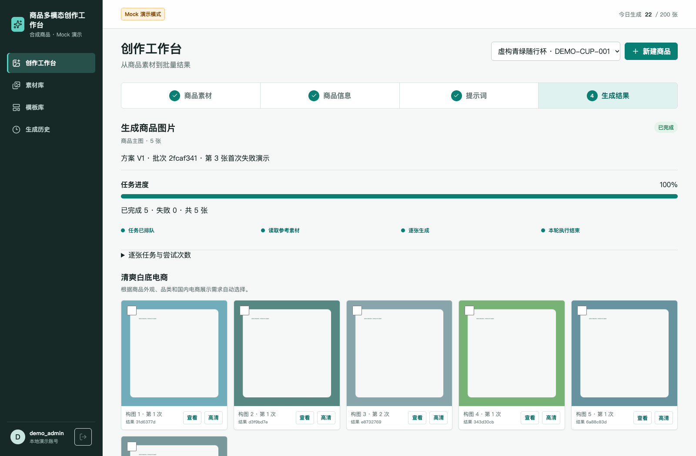
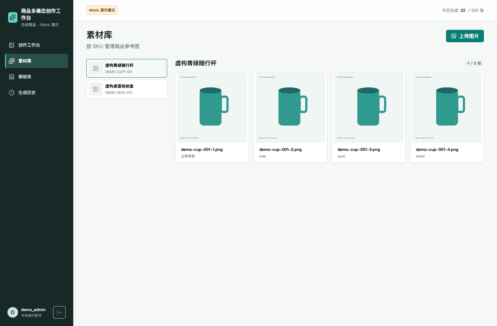

# 商品多模态创作工作台

完整应用脱敏展示版：商品档案、素材库、识别与人工确认、多图策划、异步生成、局部重试、图片修订、高清定稿、模板复用、历史检索和下载均保留。

[页面截图](docs/screenshots.md) · [功能与源码导航](docs/modules.md) · [快速启动](#快速启动) · [版本与验证](docs/validation.md) · [v0.2.0-full-project](https://github.com/wenzuowei333/commerce-creative-workflow/releases/tag/v0.2.0-full-project)



## 项目覆盖

| 模块 | 内容 | 源码 |
|---|---|---|
| 商品与素材 | 多商品档案、图片上传、主图与角度、回收站 | `backend/app/api/products.py`、`assets.py`，`frontend/src/pages/AssetsPage.tsx` |
| 商品识别 | 参考图上下文、结构化商品信息、风险项与人工确认 | `backend/app/api/analysis.py`，`frontend/src/features/workbench/AnalysisStep.tsx` |
| 视觉策划 | 多图方向、提示词、人工修改与确认 | `backend/app/api/prompts.py`，`PromptStep.tsx` |
| 异步生成 | PostgreSQL 状态、Redis/Dramatiq、进度、SSE、租约恢复与单项重试 | `backend/app/services/generation*.py`、`workers/` |
| 结果编辑 | 逐图修订、高清定稿、版本关系、图片选择与下载 | `backend/app/api/results.py`、`downloads.py` |
| 模板 | 保存策划为模板、变量替换与应用 | `backend/app/api/templates.py`，`frontend/src/pages/TemplatesPage.tsx` |
| 历史 | 按商品和任务状态查询、结果回看与刷新恢复 | `backend/app/api/history.py`，`HistoryPage.tsx` |
| 工程配套 | 登录、CSRF、幂等、限额、指标、备份恢复及部署模板 | `security.py`、`ops.py`、`scripts/`、`deploy/` |




更多实际页面见 **[页面截图集](docs/screenshots.md)**。截图只使用虚构商品与程序绘制的测试素材；图片输出明确为 Mock，未冒充真实生图质量。

## 快速启动

```bash
git clone https://github.com/wenzuowei333/commerce-creative-workflow.git
cd commerce-creative-workflow
docker compose --profile app up -d --build --wait
```

打开 **http://127.0.0.1:18140/image-studio/**。账号 `demo_admin`，密码 `LocalDemo-2026!`；`demo_other` 是相同密码的隔离账号。

默认使用 PostgreSQL、Redis、独立 Dramatiq Worker、本地媒体和 Mock Provider。包含两件虚构商品、8 张参考图；新建数据库不预置“已经执行成功”的批次。进入工作台后可完成识别、确认、策划、生成、只重试失败图、修订、高清定稿、模板保存及历史查看。

```bash
# 日常关闭；加 -v 才清空本演示专用卷
docker compose --profile app down
```

前端构建后由 FastAPI 在 `/image-studio/` 提供完整应用。开发服务器可使用 `VITE_DEMO_API_TARGET` 指定本机 API；刷新复现检查以构建后的入口为准。

## 工程与版本

FastAPI / SQLAlchemy / Alembic / PostgreSQL / Redis / Dramatiq；React / TypeScript / Vite / TanStack Query。主流程和工程能力保留，模板与高清定稿在本版默认启用；补回部署及维护工具，延续此前已验收的状态恢复、权限隔离和旧 Worker 结果保护修正。

COS、外部模型适配器及生产就绪检查的源码保留；演示配置不接入实际云桶或付费模型。Mock 用于验证产品行为和工程机制，真实模型质量与生产统计需使用对应版本和独立证据。

所选 GitHub 源快照早于后续本地维护版本，本版覆盖该快照的完整应用模块。旧版 `v0.1.0-showcase` 及其流程录屏保留；本版以 `v0.2.0-full-project` 和完整截图展示项目。

[模块说明](docs/modules.md) · [源文件覆盖与变更](docs/source-coverage-full.json) · [依赖许可清单](docs/dependency-licenses-full.json)。保留原有权利与第三方许可，没有新增项目开源许可。
