# 商品多模态策划与可靠生图工作流

**已完成阶段四：多角度素材 → 商品识别 → 风险字段人工确认 → 视觉策划 → 策划确认 → 异步批量生图 → 部分失败 → 仅重试失败项。** 商品、参考素材和模型响应均为合成或 Mock，无需 API Key。

保留锁定版本的 React 工作台、拆分 FastAPI 服务、Provider 接口、PostgreSQL 模型、Redis/Dramatiq 队列、逐张任务和图片版本。为脱敏演示补充明确的故障场景、版本关联、确认校验和迟到回写隔离，详见 [适配说明](docs/phase4-adaptations.md)。

## 一键启动

需要 Docker Compose。从本候选目录执行：

```sh
docker compose --profile app up -d --build api worker recovery --wait
```

打开 **http://127.0.0.1:18140/image-studio/**。

| 账号 | 初始可见内容 |
|---|---|
| demo_admin | 虚构青绿随行杯、虚构桌面收纳盒，各 4 张合成参考图 |
| demo_other | 空商品库，用于验证所有权隔离 |

密码统一为 `LocalDemo-2026!`，只供本机隔离演示。登录页也显示演示账号说明。数据库、Redis 和网页均仅绑定 127.0.0.1；模型/对象存储凭据为空，不隐式读取 `.env`。

首次启动执行迁移与种子初始化。已有识图记录时种子脚本保留工作流，不把进度或图片重置成初始状态。实际任务与结果均由工作流产生，没有将磁盘样例写成成功任务。

## 演示顺序

1. 选择随行杯，查看 4 张参考示意图和主参考图；可调整角度/主图。
2. 点击“识别商品信息”。Mock 返回固定档案与需要人工确认的未知材质字段；它不代表真实识图效果。勾选风险字段“人工确认”，未知可保留未知，再确认商品信息。后端同样阻止跳过确认。
3. 选择主图或详情图、5/10/15 张，生成策划并确认。首轮默认 5 张；新建方案可再次选择数量。
4. 选择“第 3 张首次失败，手动重试”，开始生成。Redis/Dramatiq 独立进程执行后得到 4 成功、1 失败；100% 表示本轮结束，成功/失败数另列。
5. 刷新页面，状态与结果从数据库恢复。点击“仅补生成失败图片”；最后 5 张完成，尝试次数为 `[1,1,2,1,1]`，其余 4 张结果 ID 保持不变。
6. 收纳盒可选择“全部正常生成”。切换 demo_other 后看不到管理员商品、参考图、批次、成图和历史。生成结果可选中下载，局部修订保留父/子版本关联。

素材和输出都有 Mock/合成标识。程序占位图用于演示编排，不是可售用商品摄影或真实生图质量样例。

## 关键机制

```mermaid
flowchart LR
  A[参考图与主图顺序] --> B[Mock识图]
  B --> C[人工确认风险字段]
  C --> D[策划Schema与版本确认]
  D --> E[批次幂等与逐张任务]
  E --> F[Redis Dramatiq]
  F --> G[数据库CAS领取与心跳]
  G --> H[生成与图像校验]
  H --> I[租约持有者复核]
  I --> J[图片与任务事件落库]
  J --> K[SSE加轮询与刷新恢复]
  K --> L[仅重试失败项]
```



批次创建冻结方案设置并关联确认过的识图版本；重新识图后旧方案不能用于创建新批次。手动重试也使用幂等键。后台恢复进程重发已提交的 queued 项并接管过期租约，数据库条件领取抵御重复消息；写回按 token、有效租约、状态和 attempts 再验证。

本地展示使用短租约 12 秒/心跳 2 秒。测试缩短为 1.5 秒/0.2 秒，并实际执行 SIGKILL、SIGSTOP/SIGCONT。用量以 UTC 日计，每个实际执行尝试记一次；Mock 没有模型账单。

## 测试与开发

Python 3.12、Node 24；推荐独立虚拟环境：

```sh
uv venv --python 3.12
uv pip install -r backend/requirements-dev.lock
.venv/bin/python demo/run_checks.py
```

脚本先运行保留的源回归测试，再启动 25437/26381 端口的专用临时 PostgreSQL/Redis，执行真实队列/并发/进程故障测试。仅重置测试库，演示库 25436/26380 不参与。

前端：

```sh
cd frontend
npm ci
npm test
npm run typecheck
npm run build
npm run test:e2e
```

浏览器验收默认使用本机 Chrome 和已启动的本候选端口 18140；会真实操作两个合成商品、创建识图/策划和批次。仅允许本机该端口。使用 Playwright Chromium 时先 `npx playwright install chromium`，并以 `E2E_BROWSER_CHANNEL=chromium npm run test:e2e` 运行。

本机开发 API 先 `docker compose up -d postgres redis --wait`，再 `.venv/bin/python demo/bootstrap.py`；从 backend 目录使用虚拟环境运行 Uvicorn。单独运行 `dramatiq app.workers.tasks --processes 1 --threads 2` 与 `python -m app.workers.recovery`。前端 Vite 代理端口见 `frontend/vite.config.ts`。

实际验收结果：42 项源回归、21 项 PostgreSQL/Redis 集成、7 项前端测试、3 组浏览器用例通过。来源与证据口径见 [验收说明](docs/phase4-acceptance.md) 与 [来源清单](docs/source-provenance-phase4.json)。运行报告和截图写入 Git 排除的 `runtime/`。

## 停止与范围

停止：`docker compose --profile app stop`。重置本候选全部演示数据：先 `docker compose --profile app down -v`，再重新启动；只删除此 Compose 项目的专用数据库、Redis 和媒体卷。

此版是受人工确认约束的多模态工作流；识图/策划/修订为同步调用，初始批量生图走 Dramatiq。真实模型质量、外部收费严格一次、生产规模、完整依赖哈希失效链、模型安全评测不在本次承诺中。没有 MCP、LangGraph 或混合检索。尚未发布 GitHub；两项目统一复现/CI与招聘材料仍在后续阶段。
