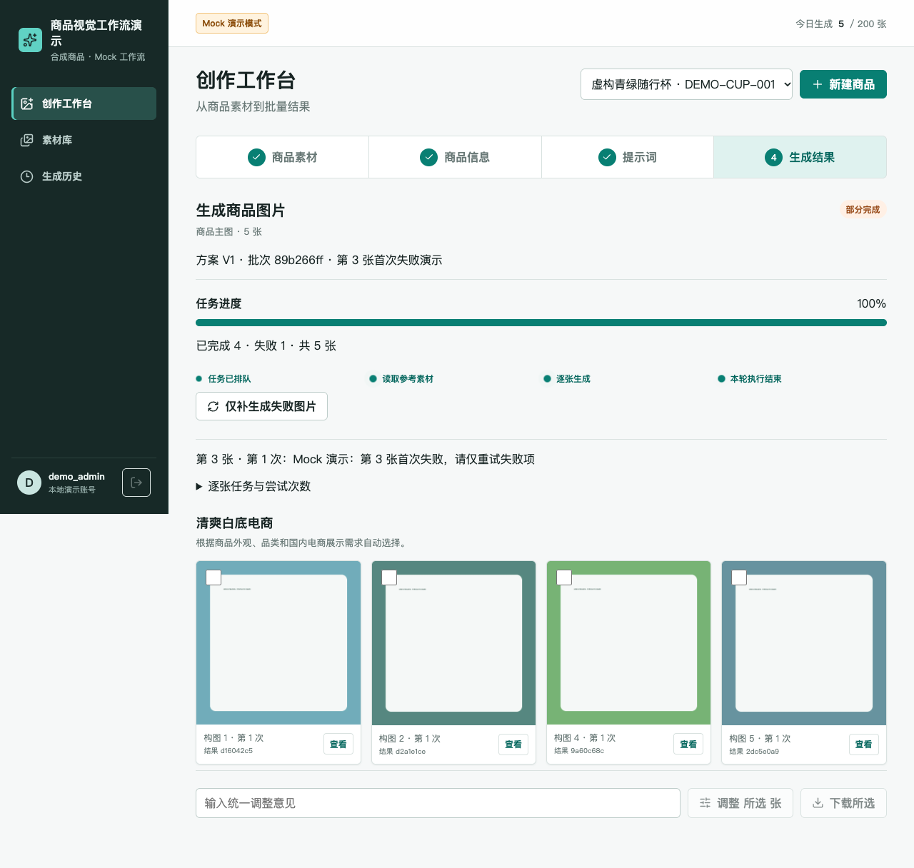

# 商品多模态策划与可靠生图工作流

[](https://github.com/wenzuowei333/commerce-creative-workflow/actions/workflows/ci.yml) · [v0.1.0-showcase](https://github.com/wenzuowei333/commerce-creative-workflow/releases/tag/v0.1.0-showcase) · [作者主页](https://github.com/wenzuowei333)

把商品素材、识图确认、视觉策划和逐图生成串成可恢复的人工确认工作流。

**个人职责：原项目独立全栈开发，负责需求梳理、系统设计、前后端实现与部署。** 本仓库仅展示其中可核验的工作流切片；职责源于项目经历自述，源实现与本次展示适配分开记录。

`Python` · `FastAPI` · `PostgreSQL` · `React / TypeScript` · `Redis / Dramatiq` · `SSE`



▶ **[观看 约 80 秒实际操作录屏](docs/assets/demo.mp4)** · [分镜与字幕](docs/demo-script.md) · [90 秒／5 分钟面试讲解](docs/interview-guide.md)

录屏由本候选业务代码在独立本机环境运行产生，按实际时间录制，只增加讲解字幕。模型响应和图片均为 Mock/程序合成；页面状态来自 API、数据库和独立 Worker。视频不是模型效果评测。

## 三个可复核的技术点

| 技术点 | 直接证据 |
|---|---|
| 人工确认与版本关联是后端约束 | [实现](backend/app/api/analysis.py#L105) · [复现测试](checks/test_workflow_postgres.py#L48) |
| 幂等批次与仅失败项重试 | [实现](backend/app/services/generation_batches.py#L197) · [复现测试](checks/test_workflow_postgres.py#L109) |
| 队列可重复投递，结果写入须持有租约 | [实现](backend/app/services/generation_execution.py#L142) · [复现测试](checks/test_workflow_postgres.py#L222) |

[架构与关键时序](docs/architecture.md) · [三个设计取舍](docs/design-decisions.md) · [简历主张与证据](docs/resume-evidence.md)

## 启动与演示

需要 Docker Engine、Compose 2.24.4+；首次构建需要访问依赖源，依赖镜像已锁定内容摘要。在项目根目录执行：

```sh
docker compose --profile app up -d --build api worker recovery --wait
```

打开 **http://127.0.0.1:18140/image-studio/**。首次启动自动执行迁移与合成种子；已有工作流数据会保留。请先确保默认演示端口未占用；另建 Compose 项目时也需分别覆盖宿主机端口。

| 演示账号 | 范围 |
|---|---|
| demo_admin | 两个虚构商品、各四张参考图 |
| demo_other | 空商品库；不能读取管理员素材、批次、事件、图片 |

统一演示密码：`LocalDemo-2026!`，仅用于本机隔离环境。停止：`docker compose --profile app stop`。恢复与删除专用数据卷的区别、开发方式及端口见 [完整运行手册](docs/runbook.md)。

推荐路径：随行杯四张参考图 → 识图 → 保留未知材质并人工确认 → 5 张策划并确认 → 第 3 张首次失败场景 → 4+1 → 刷新 → 仅重试失败项 → 5 张完成。

[正常／失败场景与预期](docs/demo-scenarios.md) 说明每一步输入、操作和结果判定，不用 HTTP 200 代替业务成功。

## 已实际验证

2026-11-03 阶段五：**42 项源回归 + 21 项 PostgreSQL/Redis 集成 + 7 项前端测试，另有 3 组浏览器用例，最终无失败或跳过。** 已通过干净检出、新数据卷、重复种子和再次新卷重建。阶段六只新增展示文档与媒体，业务实现保持阶段五版本；录屏路径另外实际执行。

[可携带的脱敏验收摘要](docs/assets/acceptance-summary.json) · [测试口径与命令](docs/evaluation.md) · [阶段五详细说明](docs/phase5-acceptance.md)

```sh
uv venv --python 3.12
uv pip install -r backend/requirements-dev.lock
.venv/bin/python demo/run_checks.py
```

前述命令执行后端测试，需要专用测试端口空闲；完整离线运行策略、浏览器与空卷复现入口见 [evaluation.md](docs/evaluation.md)。不声称首次下载“五分钟启动”。GitHub Actions 状态见页首徽章；各次运行的实际结果与过滤摘要见 Actions。本地历史验收与远程执行分别记录。

## 版本、数据与许可

这是用于招聘展示的脱敏切片，公开源码、合成数据、设计说明与 Mock 演示。源快照、逐字复用／展示适配与后续未同步能力见 [版本边界](docs/version-scope.md)。

本版没有完整依赖哈希失效图、混合检索或自主 Agent 规划。识图／策划／修订为同步阶段，初始批量生图通过队列执行；租约不能保证外部模型调用和收费严格一次。

数据、账号与商品均为固定合成样本，参考图与 Mock 输出为程序素材，见 [脱敏记录](docs/redaction.md)、[素材来源](demo/ASSET_SOURCES.md)。上游未携带 LICENSE/COPYING/NOTICE；未额外授予开源许可。依赖保留各自许可，详见 [来源与许可边界](docs/licensing.md) 和 [第三方声明](THIRD_PARTY_NOTICES.md)。本次发布保留原有权利，未新增开源许可证；公开可读不等于授予任意再分发许可。

## 发布与复现

```sh
git clone https://github.com/wenzuowei333/commerce-creative-workflow.git
cd commerce-creative-workflow
git checkout v0.1.0-showcase
```

[发布范围与验证方式](docs/publication.md) · [下载录屏](https://github.com/wenzuowei333/commerce-creative-workflow/releases/download/v0.1.0-showcase/demo.mp4)。录屏与测试为 Mock 工作流证据，不代表真实模型质量。
