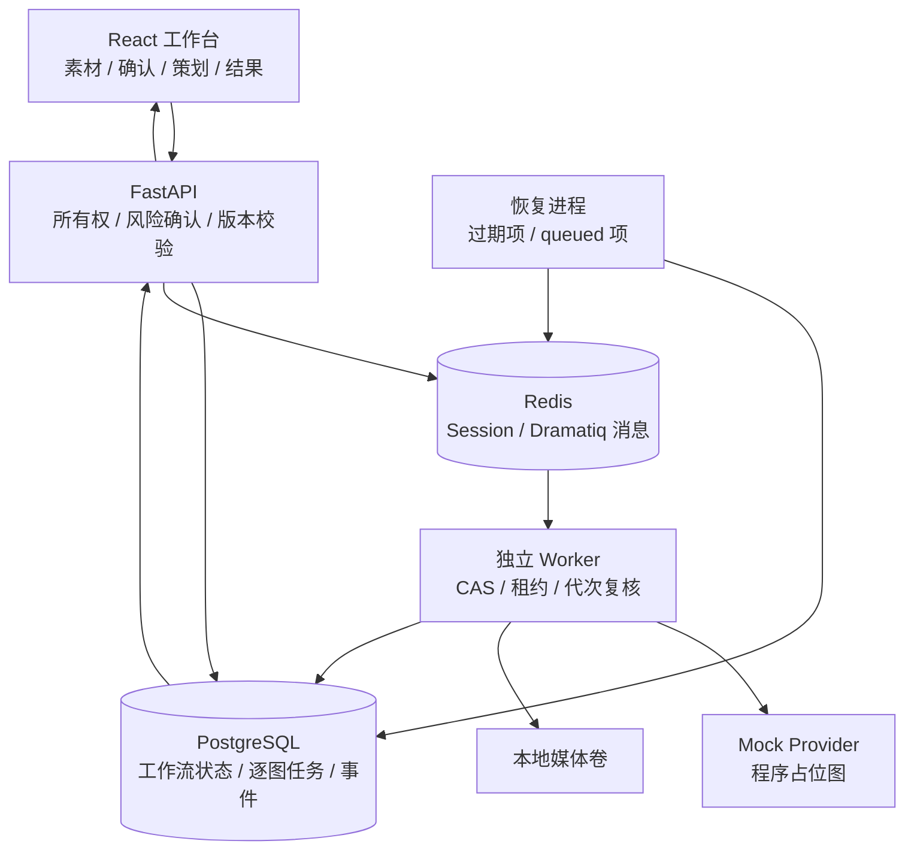
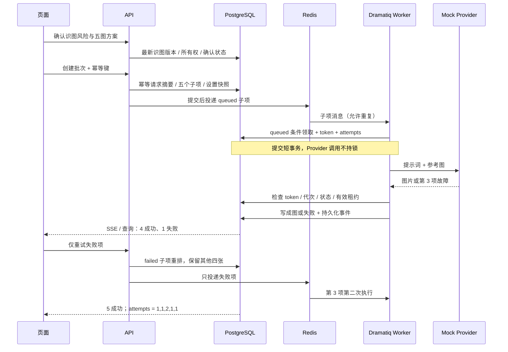

# 架构与关键时序

本版把商品事实确认、视觉策划确认和批量生成分开。识图、策划与修订是同步阶段；只有初始逐图生成通过 Redis/Dramatiq。展示部署由 React 同源页面、FastAPI、独立 Worker、恢复进程、PostgreSQL、Redis 与本地媒体卷组成。

Redis 承载 session 与消息，PostgreSQL 是工作流状态权威；浏览器根据持久化历史恢复当前批次。主参考图优先、随后按 position 排序。批次冻结设置，但执行时仍读取当前商品的 ready 参考素材，不声称完整历史依赖快照。

关键入口：[风险确认](../backend/app/api/analysis.py#L105)、[方案版本](../backend/app/services/plan_validation.py#L61)、[幂等提交](../backend/app/api/generation.py#L58)、[领取与写回](../backend/app/services/generation_execution.py#L142)、[恢复](../backend/app/services/generation_recovery.py#L11)。

媒体文件写入与数据库提交不构成跨资源事务；目前没有保证崩溃下零孤立文件。短全局 advisory 锁简化领取/恢复/重试顺序，限制吞吐。外部模型与对象存储接口保留在代码中，本轮仅用 Mock 与本地媒体。

源实现和新增版本关联、设置快照、回写隔离见 [适配说明](phase4-adaptations.md)。

可导出图：[架构 SVG](assets/architecture.svg) · [关键时序 SVG](assets/sequence.svg)。Mermaid 源码保留在本页，便于后续维护。
